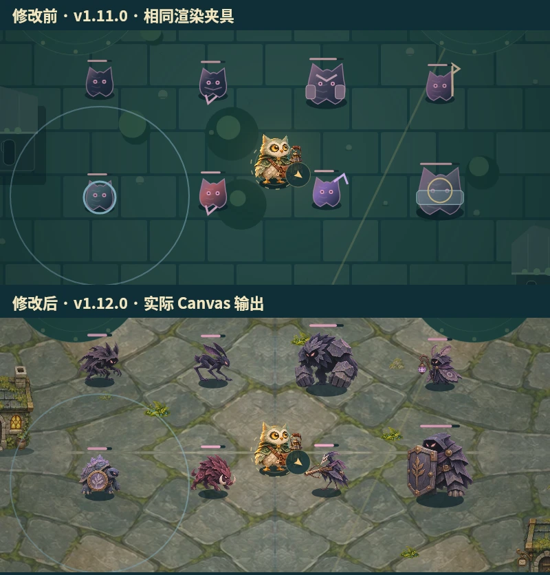

# v1.12.0 全美术检阅与实装

本轮以 v1.11.0 为运行时基线，补齐怪物与场景的实际绘制，并统一到烛羽的手绘童话材质。新增 **74 个可追溯图块 / 10 张 WebP**，完整静态壳为 53 个文件、约 5.30 MiB。所有贴图由项目原创图像生成，引用现有烛羽原画作为风格参照；没有引入外部角色或版权素材。

对照图来自原版和新版实际 `Renderer.draw`，使用相同相机、角色与怪物位置的视觉夹具，用于比较画面，不是实际通关证据。Android 的战斗、背包与图鉴截图另由正常 UI 操作的仪器测试保存。

## 检阅清单

| 类别 | v1.11.0 缺口 / 本轮处理 | 实际使用处 |
| --- | --- | --- |
| 烛羽三套皮肤 | 保留原画；检查比例、透明边缘和不同背景辨识度。浮动、朝向、残影与受击反馈保留 | 战斗、标题、衣橱、头像 |
| 四件武器 | 保留已有原创图片；与本轮装备、被动图标统一阴影和尺寸约束 | 起手、选卡、武器栏、构筑与实体 |
| 普通怪 8 类 | 原来共享相似程序轮廓；换为独立手绘原画，按原半径缩放、朝向玩家，保持受击变亮、冻结提示与出生预警 | 全部剧情 / 无尽战斗、图鉴 |
| 首领 5 种 | 原来主要依赖换色和附加线条；换为独立大型轮廓，保持阶段光圈与原招式预警 | 首领战、图鉴 |
| 无尽地图 7 张 | 原来主要是地砖色差；全部更换独立材质，镜像铺设避免放大糊化，保留各自地图几何 | 残钟、雨巷、风口、庭院、运河、长街、屋脊 |
| 剧情三章 | 沉灯街用钟纹石街、雨眠庭用荧苔庭院、无晓钟楼用独立星盘玄武石地面 | 原三章及全部旧存档 |
| 建筑 | 原多边形屋顶换为石屋、花房与机械钟舍；建筑基底严格匹配已有障碍矩形，屋顶在角色经过后方时变淡 | 全部障碍物 |
| 场景道具 9 类 | 灯塔、开 / 闭箱、商店、井、钟、邮箱、风险旗、出口门全部接入图块 | 真实 POI 与灯塔状态 |
| 居民 3 人 | 小朔、苔生、岑灯分别接入完整兔 / 鹿 / 老猫头鹰原画 | 场景 NPC、剧情对话头像 |
| 装备 12 件 | 原共用 SVG 符号；全部有独立提灯、披羽、邮包图片，保持原物品身份 | 背包、装备栏、商店、开箱、收藏 |
| 被动 8 项 / 奇物 8 件 | 接入逐项对应的原创图片 | 强化、奇物选择和构筑页 |
| 绿植、拾取物 | 增加灌木、树、苔藓、花、石、信、火种、茶、星砂；无碰撞装饰保持装饰身份 | 缓存地面、拾取物、相关 UI |
| 标题插画 | 重绘暮色街区石桥与钟楼远景，当前所选皮肤仍由真实角色绘制覆盖 | 主菜单标题画布 |
| 技能特效 | 核查原四格笔触贴图、武器弹体、拖尾、击杀、冻结与范围效果；保留已有纹理和有界反馈池 | 真实战斗效果 |
| 预警 / 导航 / 操作图标 | 粉色锁线、危险圈、冷却、血条、导航与按键保持清晰程序绘制；艺术图像不覆盖预警层 | 战斗 HUD、操作区 |

## 怪物与首领映射

普通怪固定映射：迷途影 / 迅影 / 重影 / 投影者 / 结界者 / 破阵者 / 远望者 / 壁垒者。分别采用影爪、长腿迅影、石甲重拳、蛾翼法师、背盾龟灵、獠牙冲兽、长弩远望者与塔盾哨卫。

| 原首领身份 | 本轮原画 | 原规则 |
| --- | --- | --- |
| 沉钟监守 | 铜钟机械巨像 | 锁线光束 |
| 夜邮猎手 | 赤鬃角兽 | 冲锋锁线 |
| 暴雨领主 | 浮空星象术士 | 环形弹雨 |
| 烬潮审判 | 提灯鸦翼监守 | 扩散震荡 |
| 星棘巡狩 | 棘冠鹿角骑士 | 飞弹与光束 |
| 剧情守夜者 | 提灯鸦翼监守 | 原剧情压灯与定向回声 |

## 图层、兼容与交付检查

- 地面与地面技能在下层；建筑、NPC、灯塔、敌人与烛羽按接地点排序；危险预警保持在上层。新怪物血条上移，避免压住头部。
- 图块在运行时按明确像素坐标裁切；人物和图标保持原宽高比。只有地面和需匹配既有碰撞面的建筑做目标矩形映射。
- 全部图像通过同一 `artReady` 共享预载；缺图时怪物、建筑、道具和地面保留原绘制回退。所有新运行资源进入原子离线预缓存。
- 本轮没有改变地图、碰撞、刷怪、伤害、掉落、随机流、存档 schema / 键或原生身份。增加渲染前后序列化相等与三位居民头像边界的检查，并保留所有历史重放。
- 本地 259 项测试通过，包含原 254 项；静态 / 离线 / 版本检查与 `git diff --check` 通过。
- Android 保留原 9 项仪器用例，增加第 10 项：实际离线解码全部新贴图、正常剧情开局、观察实际图片绘制、背包与图鉴图片、暂停和继续。真实设备画面截图命名 `world / inventory / codex-landscape.png`，由既有提交帧门禁采集；运行环境是 Android 模拟器。
- Windows 仍需通过原工作流的实际免安装 EXE 启动、渲染、存取档、沙箱和资源哈希验收，全部平台通过才允许发布。

来源 / SHA-256：[v1.12-assets.json](v1.12-assets.json)。完整生成规格：[v1.12-prompts.json](v1.12-prompts.json)。全部图块检阅：[图集](v1.12-catalog.webp)。

范围说明：本轮人物与怪物采用完整静态原画配合朝向、浮动、受击回弹和拖影；没有声称制作逐帧骨骼 / 行走动画。真实手机上的性能与观感仍以用户设备反馈为准。
